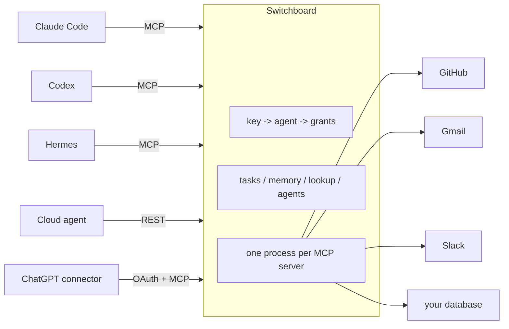

# Switchboard

One front door for all your AI agents.

Switchboard runs each of your MCP servers once and lets any number of agents use them, each with its
own key, its own list of allowed tools, and its own line in the audit log. On top of that it gives the
agents a few shared things so they can work as a team instead of a pile of separate chat windows:

- a **shared task list** with claims, so two agents never do the same job
- a **shared memory** of facts and house rules, so a correction you give one agent reaches all of them
- a **directory** for quick lookups, so agents stop pulling 200 KB lists to find one person
- **agent-to-agent requests**, so one agent can ask another for help or temporary access, with you
  approving

I built this to run my own businesses with Claude Code, Codex, Hermes and a couple of cloud agents
all working at once. It has been running in production every day since September 2026. People asked
how it works, so here it is.

## Why

I kept adding agents. Each one wanted its own copy of every connector (email, calendar, Slack,
GitHub, the store, the database), its own credentials, and its own way of keeping track of what it was
doing. That broke in three ways:

1. **Too many processes.** Every agent process started its own copy of every MCP server. One agent
   with three processes and 22 connectors meant 71 MCP processes and over 3 GB of memory.
2. **Credential fights.** Two copies of the same OAuth connector would race to refresh a rotating
   token, and one of them would lose and break.
3. **Duplicate work.** Agents had no idea what the others were doing. Two would pick up the same
   job, or one would redo something another finished yesterday.

Switchboard fixed all three. Connectors run once. Agents connect over HTTP with a key. And every agent
checks in with the same task list before starting anything.

## How it works



- `POST /mcp/<connector>` serves one connector as a normal MCP server (Streamable HTTP).
- `POST /mcp` serves everything the key is allowed to use as one server, tools named
  `<connector>__<tool>`. Handy for apps that only take one URL.
- `GET /api/openapi.json` and `POST /api/call/<connector>/<tool>` are a plain REST version for agents
  without an MCP client.
- OAuth 2.1 sign-in for apps that can't hold a static key (ChatGPT connectors). You approve each
  sign-in.

Requests are stateless, so restarting Switchboard never breaks a connected agent.

Read [How the agents work together](docs/how-agents-work-together.md) for the check-in loop, lanes,
shared memory and agent-to-agent requests. The full HTTP surface, including OAuth and every built-in
tool, is in [docs/api.md](docs/api.md); every config option is in
[docs/configuration.md](docs/configuration.md).

## Quick start

Needs Node 22.13 or newer (it uses the built-in `node:sqlite`).

```bash
git clone https://github.com/whotookmylogin/switchboard.git && cd switchboard
npm ci

mkdir -p config
cp examples/connections.example.yaml config/connections.yaml   # your MCP servers
echo 'agents: {}' > config/agents.yaml                          # empty roster; see examples/agents.example.yaml for what entries look like

npm start                                    # listens on 127.0.0.1:3930
```

Then, in a second terminal:

```bash
node bin/sb.js agent add claude-code --grant tasks --grant memory --grant github
# prints the key once. Only its sha256 is stored.
```

Then point an agent at it:

```bash
claude mcp add --scope user --transport http switchboard http://127.0.0.1:3930/mcp \
  --header "Authorization: Bearer sb_..."
```

Setup for each client, including the session-start check-in hook, is in
[`examples/clients/`](examples/clients/).

## Managing agents

`npm link` puts `sb` on your PATH (the `bin` entry already exists in package.json); otherwise run
`node bin/sb.js` in place of `sb`.

```bash
sb agent add <name> --grant "github:get_*,search_*" --grant tasks   # new agent, prints key once
sb agent grant <name> --grant "slack:post_message"                  # widen
sb agent revoke <name>                                              # key stops working now
sb agent rotate <name>                                              # new key, old one dead
sb status                                                           # every connector: up, pid, restarts
sb log <name> --since 1h                                            # what it called (ok / ERR / DENY)
sb snippet <name>                                                   # MCP config to paste into a client
```

A grant is a connector (all its tools) or `connector:tool1,tool2` with `*` globs. A `deny:` list in
`agents.yaml` always wins over grants.

Trying a new agent is one command, and it never sees your passwords. Connector secrets stay in
Switchboard's env files. The agent only ever gets a Switchboard key with the tools you picked.

## What's in the box

| Path | What |
|---|---|
| `src/index.js` | HTTP server, MCP routing, combined endpoint, audit log, cancellation |
| `src/backend.js` | Supervises one stdio MCP server: start, restart with backoff, serialize if needed |
| `src/registry.js` | `connections.yaml` + `agents.yaml`: keys (sha256 only), grants, deny lists, `${VAR}` secrets |
| `src/rest.js` | REST facade and OpenAPI generation |
| `src/oauth.js` | OAuth 2.1 sign-in with operator approval |
| `src/tasks.js`, `src/taskstore.js` | Shared task list (built-in SQLite, or Hermes' kanban) |
| `src/memory.js` | Shared memory: facts with clearance levels, notes, full history |
| `src/lookup.js` | Directory search (SQLite FTS5) |
| `src/notes.js` | Search over a folder of markdown notes, with credential redaction at index time |
| `src/arp.js` | Agent Request Protocol: pairs, requests, expiring grants |
| `src/compact.js` | Token-saving result shaping for per-token-billed agents |
| `bin/sb.js` | The `sb` admin CLI |
| `tools/lane_runner.py` | Cron job that runs headless Claude Code / Codex on ready tasks |
| `tools/directory_refresh.mjs` | Rebuilds the lookup directory from files, commands or Slack |
| `tools/watchdog.sh` | Restarts the service if `/healthz` stops answering |
| `deploy/` | systemd units and a Cloudflare Tunnel example |

## Running it for real

I run it as a systemd user service on a Linux box at home, bound to `127.0.0.1`, with a Cloudflare
Tunnel in front for the cloud agents. `/healthz` is hidden from tunnel traffic. See
[docs/deployment.md](docs/deployment.md).

Things I learned the hard way are in [docs/lessons.md](docs/lessons.md).

## Security model

- Keys are stored as sha256 hashes. `sb agent add` shows a key once.
- Every tool call checks the caller's grants and deny list. Built-in connectors take the caller's
  identity from the key, never from tool arguments.
- The audit log records who called what, how long it took and how big it was. Never the argument
  values.
- Shared memory rejects anything that looks like a password or API key, logs every read of a
  restricted value, and keeps history of every change.
- Agent-to-agent access needs your approval and expires.

See [docs/security.md](docs/security.md). This is a personal-scale tool. Read the code before you put
anything important behind it.

## License

MIT
