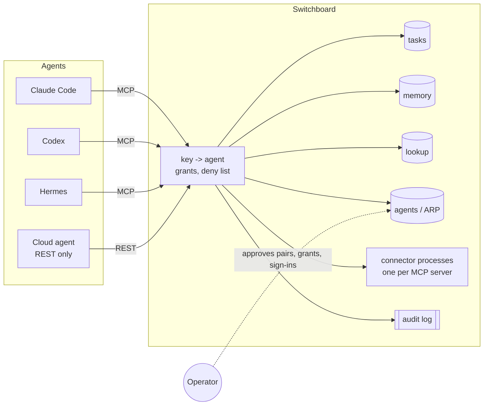

# How the agents work together

Switchboard gives every agent the same four shared things, through the same front door, each call
tagged with who made it:

| Connector | What it's for | Who writes |
|---|---|---|
| `tasks` | One task list. Claims stop two agents doing the same job. | Every agent |
| `memory` | Organization facts and house rules every agent should know. | Agents add notes; only the operator verifies |
| `lookup` | A small directory (people, channels, customers, products) so agents fetch one row instead of listing everything. | A cron job rebuilds it |
| `agents` | Agent-to-agent requests (ARP): ask another agent for info, a task, or temporary access to one of its tools. | Agents, with operator approval |

None of the agents talk to each other directly. They all talk to Switchboard, and Switchboard knows
which agent is calling from its key. An agent can't claim a task as someone else, read memory above
its clearance, or call a tool it wasn't granted.

## The check-in loop

Every agent follows the same five steps. They're in each agent's instruction file
([examples/clients/AGENTS.md](../examples/clients/AGENTS.md)) and repeated in the `tasks`
connector's own MCP instructions, so even an agent that skips its instruction file sees them.

1. **Look before starting.** `active` shows what every agent has claimed right now. `find` searches
   open tasks so you don't create a duplicate.
2. **Claim it.** `claim` takes a ready task atomically. If another agent holds it, the call fails and
   says who and until when. `start` creates a task assigned to you and claims it in one step, for work
   that wasn't on the board yet.
3. **Keep the claim alive.** Claims expire (60 minutes by default, up to 8 hours). `heartbeat`
   extends it and can add a progress note. An expired claim goes back to `ready`, so a crashed agent
   never holds a task forever.
4. **Finish with a receipt.** `complete` requires a `result`: what you did and where (branch, files,
   links). The next agent reads that instead of rediscovering it.
5. **Or hand it back.** `release` (with a reason) puts it back for someone else. `block` parks it for
   a human with exactly what's needed.

### Lanes

A task's assignee is a *lane*: an agent name that pulls its own work (`claude`, `codex`, `human`, or
whatever you list in `SB_TASK_LANES`). There's no central dispatcher deciding who does what. Each
agent asks for `list assignee=<lane> status=ready` when it starts.

Two ways a lane gets worked:

- **Interactive.** The Claude Code [SessionStart hook](../examples/clients/claude-code/) calls `active`
  and `list assignee=claude status=ready` before the first prompt and drops the answer into the session's context. So
  every new session starts knowing what's taken and what's waiting for it.
- **Headless.** [`tools/lane_runner.py`](../tools/lane_runner.py) runs on a cron. For each enabled
  lane it claims the top ready task, starts the agent's CLI (`claude -p`, `codex exec`) with the task
  as the prompt, heartbeats while it runs, and completes or blocks the task when it exits. Caps per
  lane (concurrency, tasks per day, max runtime) keep it from running away. Put `[manual]` in a title
  to keep a task for an interactive session.

The `human` lane is how an agent puts a decision in front of the operator. Anything that needs a
person (spend money, send something external, approve a design) becomes a task assigned to `human`,
not a message buried in a chat log.

## Shared memory

`memory` has two kinds of entries:

- **Facts**: `entity.field` keys like `acme.legal_name` or `acme.duns`, each with a sensitivity level
  (`public`, `internal`, `restricted`, `secret`). Each agent has a `memory_clearance` in
  `agents.yaml`. Reading a restricted value requires a reason, and every read is logged.
- **Notes**: rules, tips, gotchas, how-tos. When the operator corrects an agent, the agent calls
  `remember` and every other agent sees it on its next `recall`. Similar titles are flagged as likely
  duplicates so notes get updated instead of piling up.

Every change is kept in `history` as a snapshot of the row before the change, so nothing is ever
hard-deleted. Agents can't mark anything verified; only the operator can (`sb memory verify`). Anything
that looks like a password or API key is rejected with a pointer to use the password manager instead.

## Agent-to-agent requests (ARP)

The `agents` connector lets agents discover each other (`list`), send typed requests (`request`:
`info`, `task`, or `tool_access`), read their `inbox`, and `respond`.

The trust rules:

1. The first request between any two agents waits until the operator approves that **pair** once.
2. After that, `info` requests flow straight through (logged).
3. `tool_access` mints a grant only when both the target agent agrees *and* the operator approves.
   Grants are one connector, one tool, optionally narrowed to specific argument values, and they
   expire (7 days by default, 30 max). They never auto-renew.
4. Raw secrets are rejected from every request and response body.

The operator handles approvals with `sb arp list` and `sb arp approve|deny <id>`. Each new approval
card is also pushed to the configured notifier (`SB_NOTIFY`: log, Telegram, webhook or ntfy), so
approvals reach the operator without polling.

## Tool access and audit

- **Grants** in `agents.yaml` map connectors to tool lists (globs allowed). `"*": "*"` is everything.
  A `deny` map always wins, even over dynamic ARP grants. Use it to fence specific write tools off an
  otherwise broad grant.
- **Audit**: every call is a line in `logs/audit-YYYY-MM-DD.jsonl` with agent, connector, tool,
  duration, sizes and outcome (`ok`, `ERR`, `DENY`). Argument *values* are never logged. `sb log
  <agent> --since 1h` reads it.
- **Compact mode** (`compact: true`) trims tool descriptions, clamps page sizes and reshapes big JSON
  results for agents that pay per token. `max_result_kb` caps a single result.

## Why this shape

- **One process per connector.** Before, each agent process spawned its own copy of every MCP
  server: 71 MCP processes for 22 servers, and copies of the same OAuth connector raced each other to
  rotate refresh tokens. Now each runs once, and adding an agent costs nothing.
- **Stateless HTTP.** No MCP session ids, so restarting Switchboard never strands a client.
- **Identity from the key, never from arguments.** An agent passing `agent: "someone-else"` changes
  nothing. Claims, memory writes and ARP requests are all attributed from the bearer token.
- **Onboarding is one command.** `sb agent add <name> --grant ...` prints a key once. `sb agent
  revoke` kills it immediately. Trying a new agent doesn't mean handing it your passwords: it gets a
  key with exactly the tools you chose.
